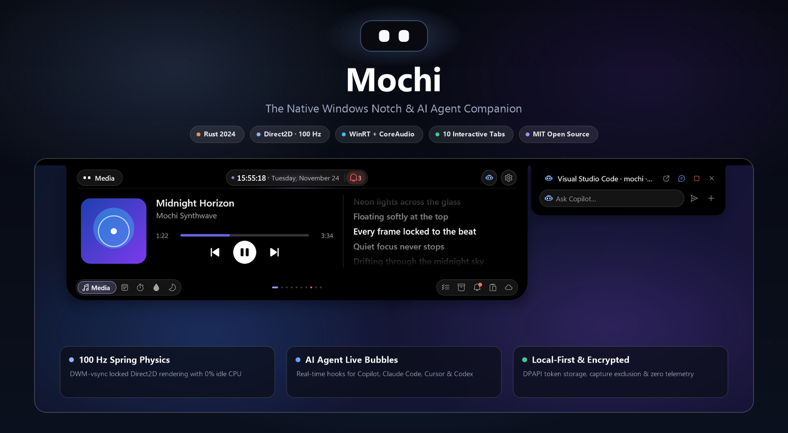
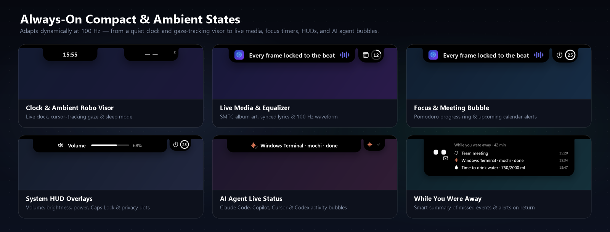
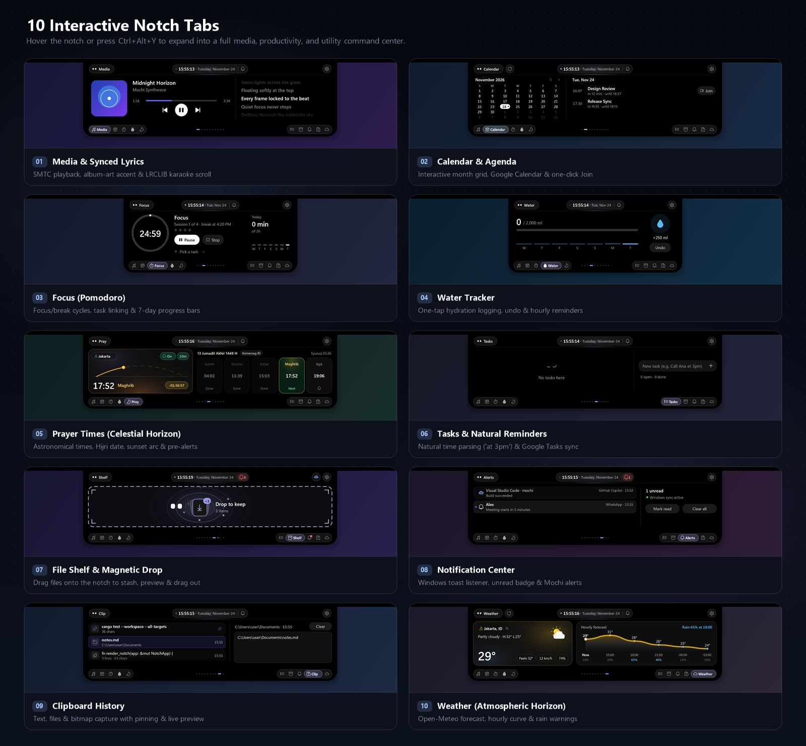
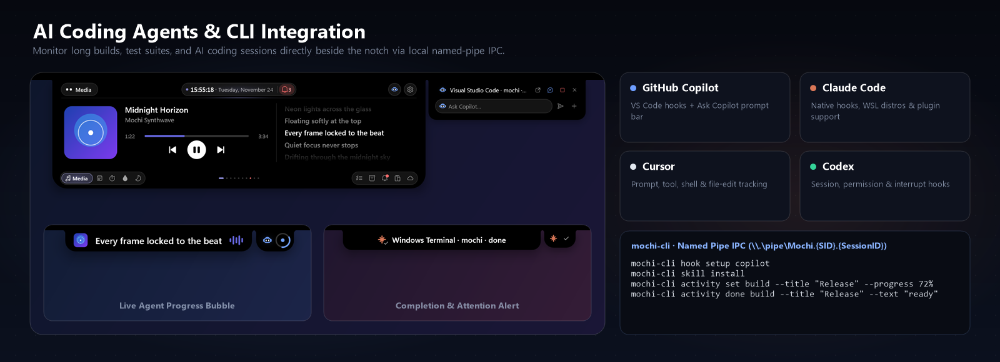
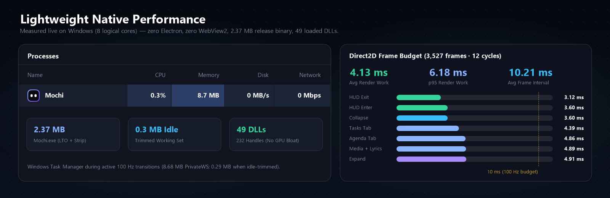
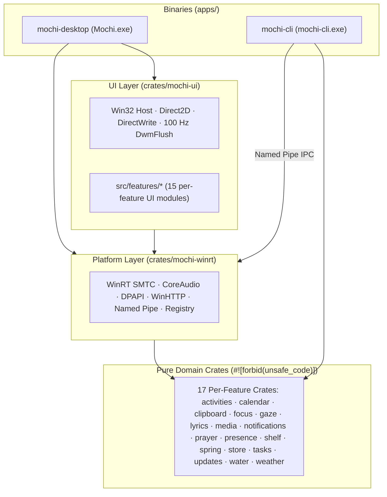

<div align="center">



<br />
<br />

# Mochi

**A native, 100 Hz Windows notch overlay and AI coding agent companion built in pure Rust.**

[](#installation)
[-EA580C?style=for-the-badge&logo=rust&logoColor=white)](#build--verify)
[](#why-mochi)
[](LICENSE)

[Features](#why-mochi) · [Compact States](#always-on-compact--ambient-states) · [10 Interactive Tabs](#10-interactive-notch-tabs) · [AI Agents & CLI](#ai-coding-agents--mochi-cli) · [Performance](#performance--benchmarks) · [Shortcuts](#keyboard-shortcuts--controls) · [Install](#installation) · [Architecture](#architecture)

</div>

---

## Why Mochi?

Mochi turns the top edge of your Windows display into a living, hardware-accelerated command center — **without Electron, WebView2, or background bloat**.

| Pillar | How Mochi Delivers It |
| :--- | :--- |
| **100 Hz Spring Physics** | Locked to `DwmFlush()` vblank with `1/240s` damped spring substeps (`mochi-spring`), dropping to **0% CPU** via `GetMessageW` when settled. Includes an optional **Calm Motion** mode. |
| **Native Direct2D + DirectWrite** | Rendered directly onto a per-pixel transparent `WS_EX_LAYERED` surface via `UpdateLayeredWindow`, with concave Bezier ears, cached 9-slice soft shadows, and `HTTRANSPARENT` click-through. |
| **Focus-Free Interaction** | Uses `WS_EX_NOACTIVATE` so hovering, scrubbing music, or checking tasks never steals focus from your game, IDE, or terminal — switching to keyboard mode only when typing in an input field. |
| **Cozmo Expressive Companion** | Features cursor-tracking eye gaze (`mochi-gaze`), autonomous glances, natural single/double blinks, sleep breathing, and reactive expressions (`idle`, `yes`, `jump`, `alert`, `no`, `thinking`, `sleep`). |
| **Local-First & Encrypted** | All state stays on your PC in `%LOCALAPPDATA%\Mochi\data.json`. Google OAuth tokens (`google.dat`) and clipboard history (`clipboard.dat`) are encrypted with **Windows DPAPI**, and screen-capture exclusion (`SetWindowDisplayAffinity`) keeps the notch private during calls. |

---

## Always-On Compact & Ambient States

<div align="center">
  
</div>

<br />

When collapsed, Mochi adapts automatically to what matters right now:

- **Clock & Ambient Robo Visor** — Displays the live time (or Cozmo's cursor-tracking eyes when idle, transitioning to a sleeping visor with `z` after inactivity).
- **Live Media & Equalizer** — Shows album art, track title or live synced lyric line, and a 100 Hz 5-bar waveform driven by Windows SMTC.
- **Focus & Meeting Bubbles** — Surfaces a live Pomodoro countdown ring or upcoming Google Calendar meeting alert (`in 12 min`) right beside the notch.
- **System HUD Overlays** — Smooth, non-intrusive pills for **Volume**, **Brightness**, **Charger & Low Battery**, **Audio Output Device**, **Caps Lock**, **Keyboard Layout**, **Network**, and **Camera/Mic Privacy Dots** (hollow mic dot when muted).
- **AI Agent Live Status** — Displays real-time progress rings, attention alerts, and completion checks from **GitHub Copilot**, **Claude Code**, **Cursor**, **Codex**, or any script via `mochi-cli`.
- **While You Were Away** — Delivers a concise summary card of missed meetings, finished agent runs, and reminders when you return to your desk.

---

## 10 Interactive Notch Tabs

<div align="center">
  
</div>

<br />

Hover the notch or press **`Ctrl+Alt+Y`** to expand into 10 purpose-built tabs:

| # | Tab | Highlights |
| :-: | :--- | :--- |
| **01** | **Media** | WinRT SMTC playback controls, player switcher, seekable progress bar, dynamic album-art accent extraction, and synced LRC lyrics via **LRCLIB** with local SHA-1 caching. |
| **02** | **Agenda** | Interactive month calendar grid, read-only **Google Calendar** sync, SafeLinks unwrapping, upcoming meeting countdowns, and one-click **Join** meeting links. |
| **03** | **Focus** | Pomodoro timer (`Focus`, `Short Break`, `Long Break`), task linking, automatic away-pause (returning unattended time), and a 7-day focus bar chart. |
| **04** | **Water** | One-tap hydration logging (`+cup`), instant undo, 7-day intake bars, and configurable hourly reminders (`08:00–22:00`). |
| **05** | **Pray** | **Celestial Horizon** astronomical prayer times, Hijri date, sunset progress arc, live countdown pill, per-prayer mute toggles, pre-alerts, and 5 calculation methods (`Kemenag RI`, `MWL`, `ISNA`, `Umm al-Qura`, `Egyptian`). |
| **06** | **Tasks** | Quick to-do list with natural trailing time parsing (`"Call Ana at 3pm"`, `"15:30"`, `"pukul 9"`), due reminders, undo toast, and optional two-way **Google Tasks** sync. |
| **07** | **Shelf** | Magnetic drag-and-drop file shelf with image thumbnails, shell icons, availability checks, drag-out support, and undo on clear. |
| **08** | **Notifications** | Windows toast notification listener + Mochi reminder history, unread badge counter, mark-all-read, and dismiss/clear sync. |
| **09** | **Clipboard** | Live clipboard history capturing text, file drops, and bitmaps with pinning, one-click copy flash, and a live preview pane. |
| **10** | **Weather** | **Atmospheric Horizon** powered by **Open-Meteo** (no account required) with animated weather scenes, hourly temperature curve, rain warnings (`>60%` in 2h), city search, and coarse (`~1 km`) Windows location lookup. |

---

## AI Coding Agents & `mochi-cli`

<div align="center">
  
</div>

<br />

Mochi ships with **`mochi-cli.exe`**, a lightweight console companion that communicates with `Mochi.exe` over a user-scoped Windows named pipe (`\\.\pipe\Mochi.{UserSID}.{SessionID}` with NetworkSid deny ACL).

### One-Command Agent Setup

```powershell
# Print or configure hooks for your AI coding agent
mochi-cli hook setup copilot
mochi-cli hook setup claude
mochi-cli hook setup cursor
mochi-cli hook setup codex

# Install the mochi-notch agent skill for Copilot, Claude Code, and .agents
mochi-cli skill install
```

> **Tip:** You can also toggle hooks for **GitHub Copilot**, **Claude Code** (including **WSL distros**), **Cursor**, and **Codex** directly from **Mochi Settings → AI agents**, and send prompts straight to VS Code Copilot from the notch's **Ask Copilot…** bar.

### Script & Build Progress Reporting

```powershell
mochi-cli activity set deploy --title "Deploy" --text "building release" --progress 35% --icon build
mochi-cli activity set deploy --title "Deploy" --text "uploading artifacts" --progress 80% --icon upload
mochi-cli activity attention deploy --title "Deploy" --text "approve production rollout?"
mochi-cli activity done deploy --title "Deploy" --text "live"
mochi-cli activity fail deploy --title "Deploy" --text "tests failed"
mochi-cli activity end deploy
```

- **Supported icons:** `activity`, `code`, `build`, `download`, `upload`, `sync`, `agent`, `bell`, `timer`, `claude`, `cursor`, `codex`, `copilot`
- **Exit codes:** `0` shown · `1` bad arguments · `2` Mochi not running · `3` refused

---

## Keyboard Shortcuts & Controls

| Shortcut / Gesture | Action |
| :--- | :--- |
| **`Ctrl+Alt+Y`** | Open or close the notch from anywhere |
| **`Ctrl+Alt+J`** | Jump to the window of the AI agent or activity that needs you (cycles on repeat press) |
| **`Ctrl+Alt+M`** | Mute or unmute the system microphone across Windows |
| **Hover top edge** | Expand the notch after the configured hover delay |
| **Scroll header / dock** | Cycle smoothly across all 10 tabs |
| **Drag files to notch** | Magnetic approach glow → drop onto the **Shelf** |
| **Right-click notch / tray** | Quick menu (`Open`, `Hide`, `Settings…`, `Mochi demo`, `Check for updates`, `Quit`) |

---

## Performance & Benchmarks

<div align="center">
  
</div>

<br />

Measured on Windows 11 (8 logical cores) using the size-optimized release LTO build (`Mochi.exe` `2.37 MB`, `mochi-cli.exe` `400 KB`):

| Metric | Measured Result | Notes |
| :--- | :--- | :--- |
| **Memory (Active / Idle)** | **`8.68 MB`** / **`0.29 MB`** | Task Manager Private Working Set during 100 Hz transitions vs idle-trimmed (`49` DLLs, `232` handles) |
| **CPU (Active / Idle)** | **`0.3%`** / **`~0%`** | Active cursor-tracking gaze; drops to `0%` via `GetMessageW` when settled |
| **Disk & Network** | **`0 MB/s`** · **`0 Mbps`** | Zero background polling; network runs only on scheduled syncs |
| **Direct2D Render Work** | **`4.13 ms`** avg · **`6.18 ms`** p95 | Measured across `3,527` frames (`12` full transition cycles via `--bench transitions`) |
| **Frame Interval** | **`10.21 ms`** avg | Locked to DWM composition vblank (`DwmFlush()`) |

<details>
<summary><strong>Per-transition Direct2D frame timing breakdown</strong></summary>

| Transition | Frames | Avg Work | p95 Work | Avg Interval |
| :--- | :---: | :---: | :---: | :---: |
| `hud-exit` (HUD exit) | 553 | `3.12 ms` | `4.41 ms` | `9.96 ms` |
| `hud` (HUD enter) | 591 | `3.60 ms` | `5.12 ms` | `9.93 ms` |
| `close` (Collapse) | 608 | `3.60 ms` | `5.13 ms` | `9.93 ms` |
| `tab-tasks` (Tasks tab) | 358 | `4.39 ms` | `6.95 ms` | `10.24 ms` |
| `tab-agenda` (Agenda tab) | 377 | `4.86 ms` | `7.64 ms` | `10.32 ms` |
| `tab-media` (Media + Lyrics) | 354 | `4.89 ms` | `6.93 ms` | `10.36 ms` |
| `open` (Expand) | 686 | `4.91 ms` | `7.67 ms` | `10.77 ms` |

</details>

---

## Installation

### Windows Installer (Recommended)

Download and run **`Mochi-Setup.exe`** (or the versioned **`Mochi-Setup-<version>.exe`** from [Releases](https://github.com/FahmiBahtiar/mochi-notch/releases/latest)):

- **Per-user install** into `%LOCALAPPDATA%\Programs\Mochi` — **no administrator rights required**.
- Optional tasks during setup: **Start Mochi with Windows**, **Create desktop shortcut**, and **Add `mochi-cli` to user `PATH`**.
- **Clean uninstall:** Automatically removes Mochi's AI agent hooks (`--remove-agent-hooks`), autostart registry entry, and `PATH` entry while preserving your personal data in `%LOCALAPPDATA%\Mochi`.
- **Languages:** English (`en`) and Indonesian (`id`), auto-detected from Windows or selectable in Settings.

### Optional: Google Calendar & Tasks OAuth

To enable Google Calendar and Google Tasks sync:
1. Create a **Desktop App** OAuth client in Google Cloud Console.
2. Place `google-client.json` in `%LOCALAPPDATA%\Mochi\` (or pass `MOCHI_GOOGLE_CLIENT_ID` and `MOCHI_GOOGLE_CLIENT_SECRET` when building from source).
3. Click **Connect with Google** in **Mochi Settings**. Tokens are stored encrypted via Windows DPAPI in `%LOCALAPPDATA%\Mochi\google.dat`.

### Useful Launch Flags

```powershell
Mochi.exe --settings          # Open the Settings window directly
Mochi.exe --show weather 30   # Open a specific tab for 30 seconds
Mochi.exe --demo              # Preview Mochi with simulated idle companion state
Mochi.exe --ambient           # Preview the ambient Robo visor
```

---

## Architecture

Mochi follows a strict **3-layer modular Rust workspace** separating `#![forbid(unsafe_code)]` domain logic, Windows OS bindings, and the Direct2D UI layer:



<details>
<summary><strong>Explore the full 21-crate workspace layout</strong></summary>

```text
.
├── apps/
│   ├── mochi-desktop/        # Desktop notch overlay binary (Mochi.exe)
│   └── mochi-cli/            # CLI & AI agent hook client (mochi-cli.exe) + 35 trycmd tests
├── crates/
│   ├── mochi-activities/     # Activity request parsing & AI agent hook translation
│   ├── mochi-calendar/       # Google Calendar parsing, SafeLinks unwrap & reminders
│   ├── mochi-clipboard/      # Clipboard history metadata, pinning & trimming
│   ├── mochi-focus/          # Pomodoro focus timer state machine
│   ├── mochi-gaze/           # Eye gaze controller, blink curves & Robo visor geometry
│   ├── mochi-lyrics/         # LRC parser & timestamp lookup
│   ├── mochi-media/          # Media player selection, naming & album art accent extraction
│   ├── mochi-notifications/  # Notification center deduplication & unread tracking
│   ├── mochi-prayer/         # Astronomical prayer times, Hijri date & countdowns
│   ├── mochi-presence/       # Idle/away tracking & away summary report types
│   ├── mochi-shelf/          # File shelf path deduplication & image extension helpers
│   ├── mochi-spring/         # Damped spring physics & notch opacity curves
│   ├── mochi-store/          # StoreData schema & JSON normalization/clamping
│   ├── mochi-tasks/          # Task list operations, natural time parsing & sync merge
│   ├── mochi-updates/        # Semantic version comparison for release checks
│   ├── mochi-water/          # Daily water tracker simulation & reminders
│   ├── mochi-weather/        # Open-Meteo weather/geocoding parsing & icon mapping
│   ├── mochi-winrt/          # Win32/WinRT/COM/CoreAudio/DPAPI/WinHTTP platform layer
│   └── mochi-ui/             # Direct2D/DirectWrite notch renderer, window host & settings UI
├── docs/
│   ├── assets/               # Production README showcase visuals
│   ├── DECISIONS.md          # Architecture Decision Records (ADR-001 .. ADR-004)
│   └── GLOSSARY.md           # Domain & symbol glossary
├── installer/                # Inno Setup 6 script & DPI-matched wizard artwork
├── integrations/             # Claude Code hooks & skill definitions
└── tools/                    # Release installer & artwork build scripts
```

</details>

---

## Build & Verify

### Prerequisites

- **OS:** Windows 10 (`19041+`) or Windows 11 (`x64`)
- **Toolchain:** Rust `1.97+` (Edition `2024`) with `rustfmt` and `clippy`
- **Installer (optional):** [Inno Setup 6](https://jrsoftware.org/isdl.php) (`winget install JRSoftware.InnoSetup`)

### Quality Gate & Release Build

```powershell
# Format, lint, and run all unit, Direct2D offscreen, and 35 CLI trycmd tests
cargo fmt --all -- --check
cargo clippy --workspace --all-targets -- -D warnings
cargo test --workspace --all-targets

# Build size-optimized release binaries (opt-level="z", LTO, panic="abort", stripped)
cargo build --release --workspace
```

Release binaries are produced at `target\release\Mochi.exe` and `target\release\mochi-cli.exe`.

### Package the Windows Installer

```powershell
./tools/build-installer.ps1 -Version 0.1.0
```

Outputs `dist\Mochi-Setup-0.1.0.exe`, `dist\Mochi-Setup.exe`, and `dist\SHA256SUMS.txt`.

---

## Documentation & License

- [Architecture Decision Records](docs/DECISIONS.md) — Workspace boundaries, Direct2D renderer design, IPC/storage compatibility, and quality gates.
- [Workspace Glossary](docs/GLOSSARY.md) — Key domain concepts and crate/symbol mapping.
- Licensed under the [MIT License](LICENSE).

